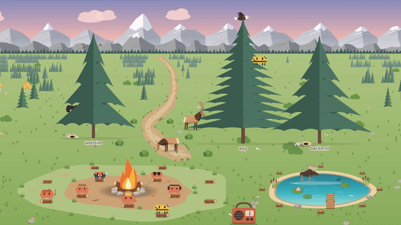

# agent-forest

A Claude Code mod that turns your repo into a forest and lets you watch your agents work.



Every top-level folder grows into a tree and every root file into a bush along the trail. Claude and its subagents sit around a campfire, then walk out to the files they read and edit, with a speech bubble saying what they're on. Web searches send them wading into the lake, and memory work sends them to the fire. Elk, bears, a moose, marmots, bighorn sheep, a loon and an eagle go about their day around them, and the light follows the real sun from dawn to night.

## Install

In Claude Code, run:

```
/plugin marketplace add Zachwitte21/agent-forest
/plugin install agent-forest@agent-forest
```

Then restart the session. You need a Claude Code version with mods support.

## Use

- The forest opens in a side pane the first time an agent touches a file. Widen the pane for the full scene.
- `/forest` opens or closes the pane.
- `/forest <path>` shows another folder. A bare name like `/forest my-app` is looked for in `~/Dev`, `~/code` and `~/Projects`.
- `/forest refresh` rescans the folder after big changes.
- Hover an agent to see its role, what it's doing and how many files it has read and edited. Hover the radio to tune into Claude FM.

The scene is drawn in the Claude desktop app. In the terminal the pane shows a short text list of what each agent is doing.

## What the agents wear

| Role | Outfit |
| --- | --- |
| Lead (Claude) | Crown |
| Explorer | Safari hat |
| Developer | Headphones |
| Planner | Suit and tie |
| Reviewer | Glasses |
| Tester | Crash-test dummy |
| Artist | Beret and palette |

A subagent's role comes from its type and description, so an `Explore` agent wears the safari hat and a "review the auth flow" agent wears glasses.

## How it works

The mod hooks tool calls and subagent spawns, works out which file each call touches (including file paths in shell commands), and moves that agent's pin there. The pane draws one SVG, scaled to fit, sized to stay under the pane's limit even for very large repos. Small repos are zoomed in so a couple of folders still fill the scene. Nothing leaves your machine: no network calls and no model calls.

## Develop

```
claude plugin validate plugins/agent-forest
claude plugin test plugins/agent-forest
```

## License

MIT
